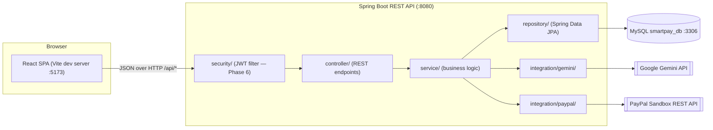
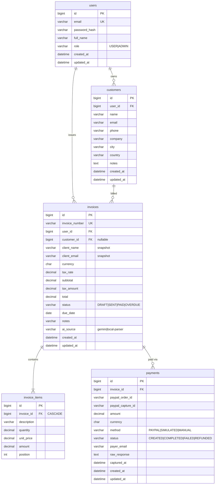
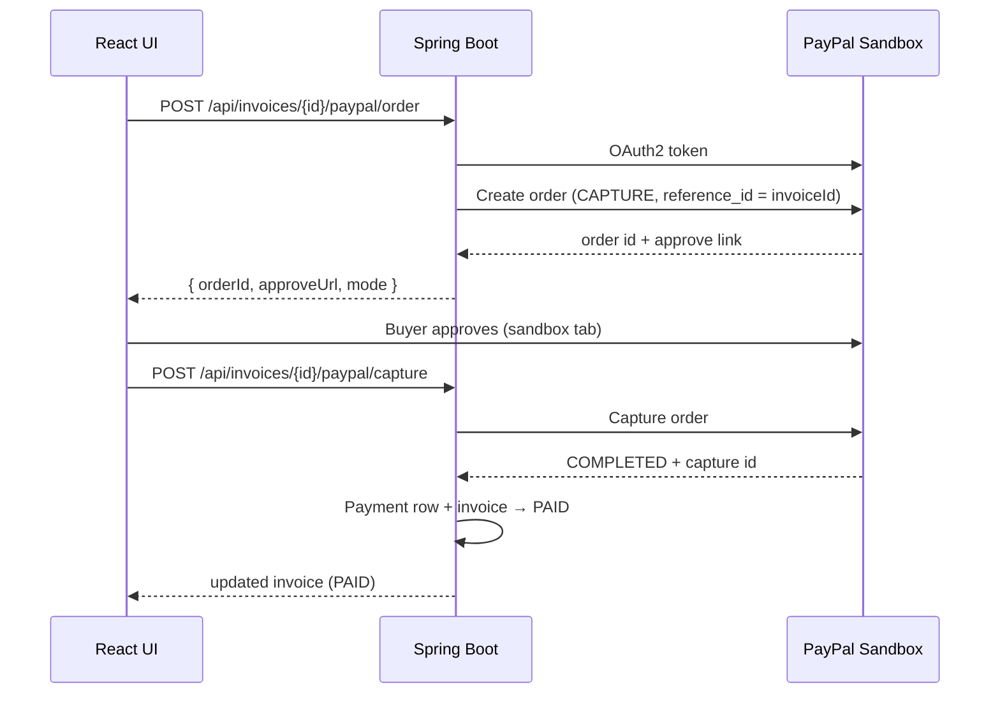
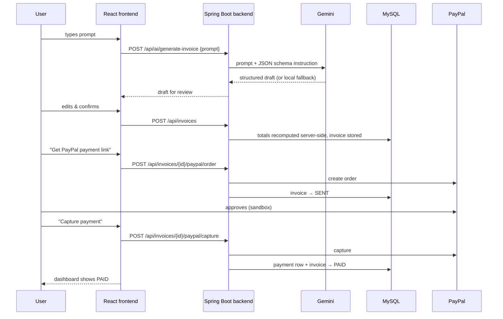

# SmartPay AI — Architecture Proposal

| | |
|---|---|
| **Project** | SmartPay AI — AI-powered invoicing & payments platform |
| **Document** | High-level architecture & implementation plan |
| **Status** | Draft — awaiting approval (no structural changes made yet) |
| **Date** | 2026-11-11 |
| **Target** | Working MVP for hackathon deadline, phased delivery |

---

## 1. Overview

SmartPay AI lets a user describe an invoice in plain natural language
("Invoice Acme Corp for 10 hours of web development at $75/hour, 18% tax,
due in 14 days"), and the system:

1. **Generates** a structured invoice draft using the **Gemini API**
   (with a built-in local parser fallback so the demo never breaks).
2. **Stores** the invoice in **MySQL** (`smartpay_db`).
3. **Collects payment** through the **PayPal REST API (Sandbox)** —
   order creation, buyer approval, capture.
4. Tracks status from `DRAFT → SENT → PAID` with a payment audit record.

**Stack:** Java 17 · Spring Boot 4.1.2 · MySQL · React + Vite · Gemini · PayPal Sandbox.

---

## 2. High-Level Architecture Diagram



Request path: **React → security filter → controller → service → repository/integration → MySQL / external APIs**.

---

## 3. Backend Architecture (Java 17 + Spring Boot)

### 3.1 Package layout

Root package `com.smartpay` inside `smartpay-backend/`:

```
com.smartpay
├── SmartpayBackendApplication.java     (exists — untouched)
├── config/                WebConfig (CORS), PayPalProperties, GeminiProperties
├── controller/            AuthController*, HealthController, CustomerController*,
│                          InvoiceController*, AiController*, PaymentController*
├── service/               AuthService*, UserService*, CustomerService*,
│                          InvoiceService, AiInvoiceService, PaymentService*
├── repository/            UserRepository*, CustomerRepository*, InvoiceRepository*,
│                          PaymentRepository*
├── entity/                User*, Customer*, Invoice, InvoiceItem, Payment*,
│                          + enums: InvoiceStatus, PaymentMethod, PaymentStatus, Role
├── dto/                   request/  (GenerateInvoiceRequest, CreateInvoiceRequest,
│                          CustomerRequest, AuthRequest…)
│                          response/ (AiInvoiceDraft, InvoiceResponse, CustomerResponse,
│                          PaymentResponse, PayPalOrderResponse, TokenResponse…)
├── integration/gemini/    GeminiClient (HTTP), GeminiInvoiceParser,
│                          LocalInvoiceParser (offline fallback)
├── integration/paypal/    PayPalClient (OAuth2 + Orders v2), PayPalProperties,
│                          dto/ (PayPalOrderDto, CaptureDto)
├── security/              JwtService, JwtAuthFilter, SecurityConfig*   (*Phase 6)
└── exception/             GlobalExceptionHandler (@RestControllerAdvice),
                          NotFoundException, IntegrationException, ErrorResponse
```

`*` = planned, not yet implemented. Items without `*` already exist (see §8 gap analysis).

### 3.2 Layering rules

| Layer | May call | Never calls |
|---|---|---|
| `controller/` | `service/`, `dto/` | `repository/`, entities directly |
| `service/` | `repository/`, `integration/`, `entity/`, `dto/` | HTTP framework details |
| `repository/` | `entity/` (Spring Data JPA) | services, controllers |
| `integration/*` | external APIs only; own DTOs | entities, repositories |
| `security/` | servlet filter chain before controllers | business logic |
| `exception/` | advice around all layers | — |

Rules of thumb: controllers are thin (validate + delegate + map); **all totals are
computed server-side**; integration clients are wrapped so a failure becomes a
clean `IntegrationException` (or triggers fallback), never a 500 with a stack trace.

### 3.3 REST conventions

- Base path `/api`, resource nouns in plural (`/api/invoices`).
- JSON, camelCase keys, ISO-8601 dates (`2026-11-25`).
- Uniform error envelope:
  `{ "timestamp", "status", "error", "message", "path" }`.
- HTTP semantics: 200/201 on success, 400 validation, 401/403 auth (Phase 6),
  404 missing resource, 502 integration failure.

---

## 4. Frontend Architecture (React + Vite)

Location: `smartpay-ai/frontend/`.

```
smartpay-ai/frontend/
├── index.html
├── package.json              react, react-dom, vite, @vitejs/plugin-react
├── vite.config.js            dev proxy: /api → http://localhost:8080
└── src/
    ├── main.jsx
    ├── App.jsx               tab-based shell (MVP) → router (optional)
    ├── assets/               logo, styles/theme.css (dark fintech theme)
    ├── components/           Navbar, StatusBadge, InvoiceTable, InvoiceForm,
    │                         ItemRow, PayPalButton, Toast, Spinner, EmptyState
    ├── pages/                DashboardPage, InvoiceGeneratorPage (AI prompt →
    │                         editable draft), InvoiceListPage, InvoiceDetailPage
    │                         (+pay flow), CustomerListPage, Login/Register* (Phase 6)
    ├── services/             apiClient.js (fetch wrapper, error envelope handling),
    │                         invoiceService, aiService, customerService,
    │                         paymentService, authService*
    ├── hooks/                useInvoices, useCustomers, useAiGenerate, usePayment
    └── context/              ToastContext (notifications), AuthContext* (Phase 6)
```

State approach: server data via custom hooks (fetch + local state), cross-cutting
notifications/auth via React Context. No Redux for MVP scope.

---

## 5. Database Design (MySQL `smartpay_db`)

Managed by Hibernate `ddl-auto=update` for the hackathon; Flyway migrations
recommended post-hackathon. Conventions: `BIGINT AUTO_INCREMENT` PKs, `*_id`
FK names, `DECIMAL(12,2)` for money, `CHAR(3)` currency codes, enums stored as
strings, `created_at`/`updated_at` on every table, `utf8mb4`.

### 5.1 ER Diagram



**Note on current code:** the existing `Invoice` entity carries
`paypal_order_id` and `payment_captured_at` inline. In the proposed schema these
move to the `payments` table (an invoice may have multiple payment attempts);
migration is a Phase 2 task and preserves all existing fields.

---

## 6. External Integrations

### 6.1 Gemini API (`integration/gemini/`)

| | |
|---|---|
| Purpose | Natural language prompt → structured invoice draft |
| Endpoint | `POST https://generativelanguage.googleapis.com/v1beta/models/{model}:generateContent` |
| Auth | `x-goog-api-key: $GEMINI_API_KEY` header |
| Model | `GEMINI_MODEL` env (default `gemini-2.0-flash`) |
| Config keys | `ai.gemini.api-key`, `ai.gemini.model`, `ai.gemini.base-url` |

Flow: `AiInvoiceService` → `GeminiClient.generate(prompt)` with a strict
system instruction ("return only JSON with keys clientName, clientEmail,
currency, taxRate, dueDate, notes, items[{description, quantity, unitPrice}]")
→ `GeminiInvoiceParser` maps/sanitizes the JSON to `AiInvoiceDraft` → service
recomputes totals server-side.

**Fallback:** `LocalInvoiceParser` (regex/heuristics for hours/rates/quantities/
tax/dates/emails) runs when no API key is configured or when the Gemini call
fails. The draft's `source` field tells the UI which engine produced it
(`gemini` / `local-parser`), so the demo works offline without pretending to
call an LLM.

### 6.2 PayPal REST API — Sandbox (`integration/paypal/`)

| | |
|---|---|
| Purpose | Real payment collection for an invoice |
| Base URL | `PAYPAL_BASE_URL` (default `https://api-m.sandbox.paypal.com`) |
| Auth | OAuth2 client-credentials → bearer token (cached until expiry) |
| Credentials | `PAYPAL_CLIENT_ID`, `PAYPAL_CLIENT_SECRET` env vars |
| APIs | `POST /v2/checkout/orders`, `POST /v2/checkout/orders/{id}/capture` |



**Simulation mode:** if sandbox credentials are absent, the pay endpoints run a
clearly-labelled `mode: "SIMULATED"` path so the end-to-end demo still works;
every response states which mode produced it. No fake data is labelled as real.

---

## 7. Application Data Flow



---

## 8. Security Design

**MVP scope (hackathon, Phases 1–5):**

| Risk | Mitigation |
|---|---|
| Secret leakage | `DB_PASSWORD`, `GEMINI_API_KEY`, `PAYPAL_CLIENT_ID/SECRET` via environment variables only; never committed |
| Injection | Spring Data JPA parameterized queries only; no dynamic SQL |
| Input abuse | Bean Validation (`spring-boot-starter-validation`) on every DTO |
| CORS abuse | Explicit allow-list (`http://localhost:5173`) in `WebConfig` |
| Error leakage | Global handler returns envelope, no stack traces |
| Money tampering | Totals always recomputed server-side from line items |

**Phase 6 (post-payments, pre-polish):**

- `spring-boot-starter-security`, BCrypt password hashing (`users.password_hash`).
- JWT access tokens (jjwt): `POST /api/auth/login` → bearer token.
- Route policy: `/api/auth/**`, `/api/health` public; everything else authenticated.
- **Ownership checks:** users can only read/modify their own customers/invoices/payments.
- Production hardening (post-hackathon): HTTPS, PayPal webhook signature
  verification, rate limiting, refresh tokens, audit logging.

---

## 9. Implementation Phases

| Phase | Scope | Exit criteria |
|---|---|---|
| **0 — done** | Skeleton, MySQL config, 3 entities (`Invoice`, `InvoiceItem`, `InvoiceStatus`), build verified | `mvnw compile` exit 0; MySQL reachable |
| **1 — restructure (needs approval)** | `model/` → `entity/` rename (content preserved); add empty packages; swap `OPENAI_*` config for `GEMINI_*` in `application.properties`; decide duplicate-backend disposition | compile + existing tests still green |
| **2 — core domain** | `Customer`, `Payment`, `User` entities; repositories; services; DTOs; invoice + customer CRUD controllers; health endpoint; exception handler | curl-verified CRUD; tables auto-created in MySQL |
| **3 — Gemini** | `integration/gemini/` client + parser + local fallback; `POST /api/ai/generate-invoice` | prompt → structured draft (live or fallback) |
| **4 — PayPal** | `integration/paypal/` OAuth2 + orders + capture; payment persistence; pay/capture endpoints | sandbox order + capture against a test invoice (or labelled simulation) |
| **5 — frontend** | Vite scaffold; generator, list, detail+pay, dashboard pages; hooks/context/services | full flow works in browser |
| **6 — security** | Users/JWT/auth, ownership checks | login-gated API |
| **7 — polish** | Demo data, README, demo script, end-to-end test run | hackathon-ready |

---

## 10. Gap Analysis — Proposed vs Existing Code

**Canonical backend for this comparison: `smartpay-backend/` (repo root).**
`smartpay-ai/backend/` is an untouched, near-identical skeleton duplicate
(see §11 decision D2).

| Proposed component | Current state in `smartpay-backend/` | Verdict |
|---|---|---|
| root app class | `SmartpayBackendApplication.java` (original, untouched) | ✅ present, compiles |
| `config/` | — | ❌ missing (CORS, properties classes planned) |
| `controller/` | — | ❌ missing (Phase 2–4) |
| `service/` | — | ❌ missing (Phase 2–4) |
| `repository/` | — | ❌ missing (Phase 2) |
| `entity/` | **`model/Invoice`, `model/InvoiceItem`, `model/InvoiceStatus` exist and compile** | ⚠️ correct content, wrong package name → rename in Phase 1 |
| `dto/` | — | ❌ missing (Phase 2) |
| `integration/gemini/` | — | ❌ missing; note: `application.properties` currently holds `OPENAI_*` placeholders → replace with `GEMINI_*` (Phase 1) |
| `integration/paypal/` | — | ❌ missing; `paypal.*` properties already in place ✅ |
| `security/` | — (no `spring-boot-starter-security` dependency) | ❌ missing (Phase 6 by design) |
| `exception/` | — | ❌ missing (Phase 2) |
| DB config | `application.properties` — MySQL + Hikari + JPA + PayPal + AI placeholders | ✅ configured (user-confirmed working MySQL; runtime check pending backend run) |
| MySQL JDBC | `com.mysql:mysql-connector-j` in `pom.xml` | ✅ verified resolving |
| Frontend | `smartpay-ai/frontend/` exists, empty | ❌ not started (Phase 5) |
| Docs | `smartpay-ai/docs/` exists, empty → this document + API doc | ✅ added now |
| DB tables | only `invoices` / `invoice_items` entities exist | ⚠️ `users`, `customers`, `payments` pending (Phase 1–2) |

### Incorrectly structured / to change (all awaiting approval)

1. **Package naming:** `com.smartpay.model` → `com.smartpay.entity` (file contents unchanged).
2. **AI provider config:** `ai.openai.*` / `OPENAI_API_KEY` placeholders → `ai.gemini.*` / `GEMINI_API_KEY` per your integration requirement.
3. **Payment data placement:** `paypal_order_id`, `payment_captured_at` currently inline on `Invoice` → move to new `payments` entity (Phase 2, data-preserving).
4. **Duplicate backend skeleton** `smartpay-ai/backend/` → decision D2 below.

---

## 11. Decisions Requested

- **D1** — Approve this architecture and the phase plan (starting with Phase 1 restructure)?
- **D2** — Backend consolidation: keep `smartpay-backend/` (root) as the single
  canonical backend (recommended — it already holds the DB config and the new
  entities) and archive/delete the untouched `smartpay-ai/backend/` duplicate?
  Or move everything under `smartpay-ai/`?
- **D3** — Security timing: implement JWT auth in Phase 6 after payments work
  (recommended for the hackathon deadline), earlier, or skip for the MVP?
- **D4** — Confirm Phase-1 property swap from OpenAI-style placeholders to Gemini.

No structural changes will be made until these are approved.
